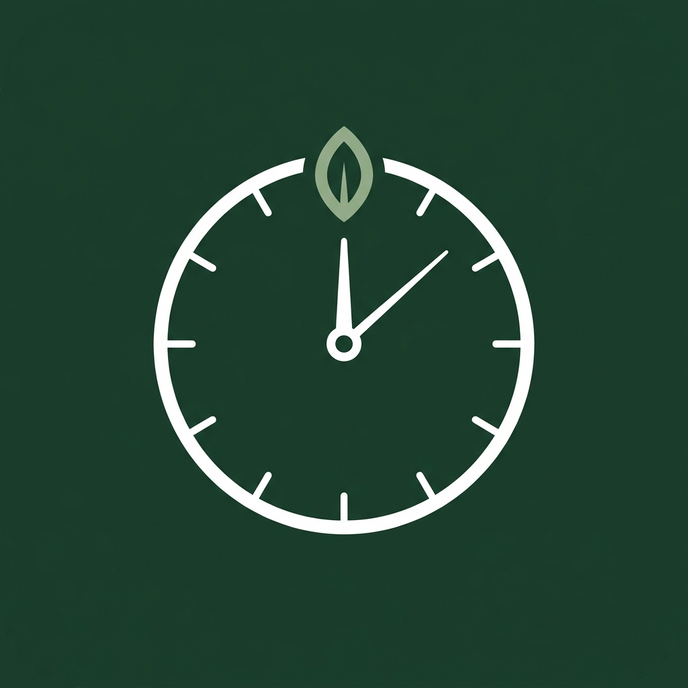
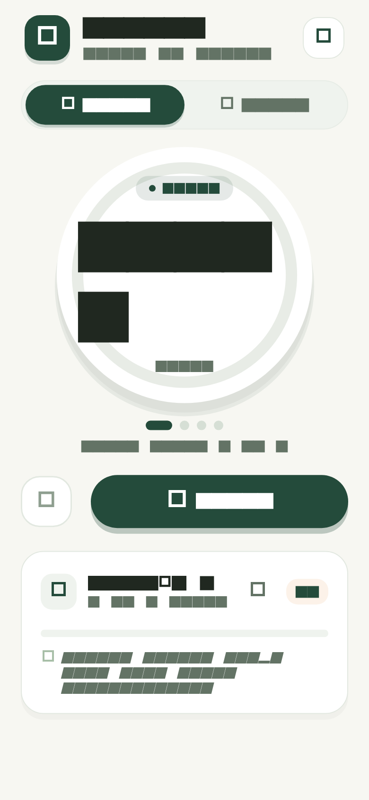
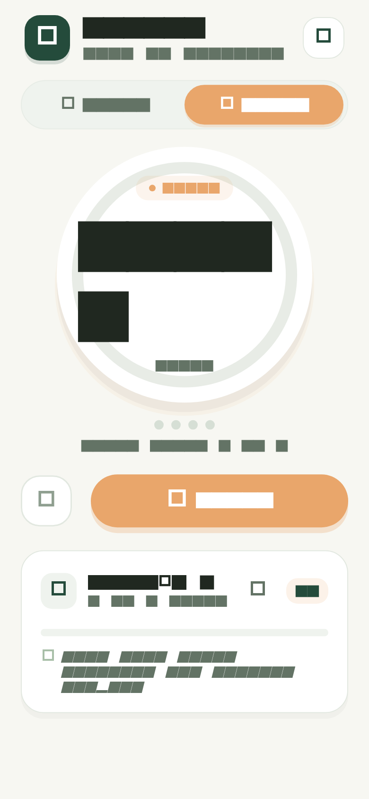
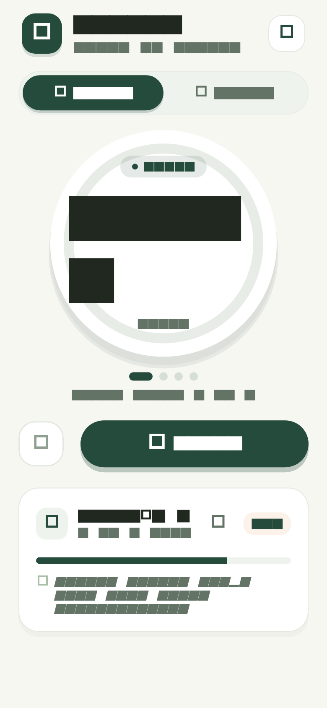
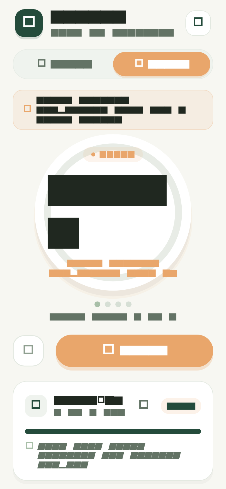
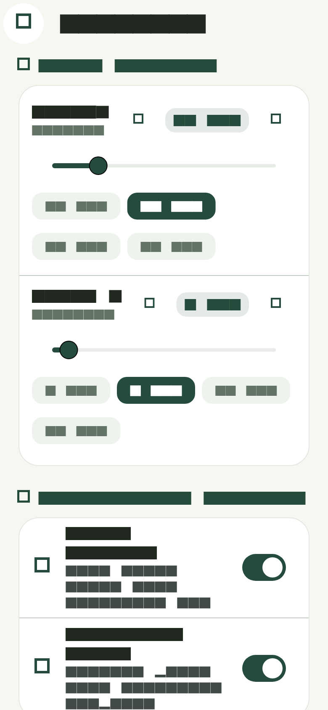

# Pomodo – Productivity Timer

<p align="center">
  
</p>

<p align="center">
  <strong>A calm, modern, and distraction-free Pomodoro productivity timer built with Flutter.</strong>
</p>

<p align="center">
  
  
  
  
  
</p>

---

## Table of Contents

- [1. Project Overview](#1-project-overview)
- [2. Problem Statement](#2-problem-statement)
- [3. Objectives](#3-objectives)
- [4. Key Features](#4-key-features)
- [5. Technology Stack](#5-technology-stack)
- [6. Application Architecture](#6-application-architecture)
- [7. Folder Structure](#7-folder-structure)
- [8. Installation Instructions](#8-installation-instructions)
  - [Flutter Environment Setup](#flutter-environment-setup)
  - [Cloning and Dependency Installation](#cloning-and-dependency-installation)
  - [Application Execution Commands](#application-execution-commands)
- [9. Testing Instructions](#9-testing-instructions)
- [10. Screenshots](#10-screenshots)
- [11. Future Enhancements](#11-future-enhancements)
- [12. Author & Contributors](#12-author--contributors)

---

## 1. Project Overview

**Pomodo** is an elegant, nature-inspired Pomodoro productivity timer engineered with Flutter. Rooted in mindful productivity and deep work principles, Pomodo pairs clean botanical aesthetics (deep forest greens, calm sage accents, and clean typography) with high-precision, drift-free timekeeping.

Whether tackling focused engineering tasks, academic study sessions, or creative writing, Pomodo guides users through rhythmic focus blocks and restful recharge intervals with audio completion chimes, subtle haptic alerts, and automatic session persistence.

---

## 2. Problem Statement

Modern knowledge workers and students frequently suffer from cognitive fatigue and digital distraction. Standard timer apps often exacerbate this problem with:
1. **Intrusive Advertisements & Clutter**: Flashy animations and banner ads that break flow state.
2. **Timing Drift & Inaccurate Countdowns**: Naive software interval timers that drift or lose seconds when the mobile OS background suspends CPU cycles.
3. **Lost Session Records on Restart**: Applications that wipe user progress whenever the operating system reclaims memory or the device restarts.
4. **Rigid Durations**: Lack of custom duration controls that adapt to varying attention spans and personal workflows.

---

## 3. Objectives

- **Deliver Drift-Free Countdown Accuracy**: Anchor every timer cycle to real-world wall-clock timestamps (`DateTime`), ensuring zero timing drift across backgrounding and foreground transitions.
- **Provide Uninterrupted Flow State**: Design a serene, distraction-free aesthetic combining deep forest greens with minimal typography and subtle feedback.
- **Ensure Reliable Offline Persistence**: Retain active countdown status, completed sessions, and daily historical records across app kills and calendar rollovers using robust local storage.
- **Build Full Cross-Platform Responsiveness**: Deliver flawless rendering across Android phone sizes (compact, standard, phablets), tablets, iOS, and Web without layout overflow errors.

---

## 4. Key Features

- ⏱️ **Precision Pomodoro Engine**: Standard 25-minute Focus mode and 5-minute Break mode with smooth countdown progression.
- 🔄 **Automatic Interval Transitions**: Seamless, hands-free progression between Focus and Break modes with clear visual status banners.
- 🎯 **Daily Productivity Tracker**: Live session counter tracking progress toward a customizable 4-session daily goal, with visual progress bars and daily history preservation.
- 📅 **Automated Midnight Rollovers**: Preserves historical records while automatically refreshing today's active session counter at 00:00 midnight.
- 🔔 **Multi-Sensory Completion Alerts**: Rich audio chimes paired with gentle device vibration, with independent user toggles.
- 🛠️ **Custom Duration Controls**: Personalize focus intervals (1–120 minutes) and break intervals (1–60 minutes) with instant preset pills or direct numerical input with real-time validation.
- 📱 **Multi-Device Responsive Design**: Adaptive layout architecture tailored for compact screens (320px), standard modern phones (390px), large devices (412px), and tablets.
- 🎨 **Adaptive Platform Branding**: Custom high-resolution vector icon assets, Android 8+ Adaptive Icons (`ic_launcher.xml`), iOS AppIcons, and Web Favicon/PWA manifest.

---

## 5. Technology Stack

- **Framework**: [Flutter](https://flutter.dev) (v3.13+ / Dart 3.0+)
- **State Management**: [Provider](https://pub.dev/packages/provider) (`ChangeNotifierProvider`, `MultiProvider`)
- **Local Persistence**: [shared_preferences](https://pub.dev/packages/shared_preferences) (Key-value caching for sessions, history, and settings)
- **Audio Playback**: [audioplayers](https://pub.dev/packages/audioplayers) (Custom audio chimes for session completion)
- **Haptics**: [vibration](https://pub.dev/packages/vibration) (Device vibration feedback)
- **Icons & Branding**: [flutter_launcher_icons](https://pub.dev/packages/flutter_launcher_icons) (Automated multi-density asset generation)
- **Testing**: `flutter_test` (Unit, Widget, Lifecycle, Drift, and Mock services)

---

## 6. Application Architecture

Pomodo follows a clean, reactive layered architectural pattern separating Presentation, Business Logic, and Data/Hardware Services:

```
┌────────────────────────────────────────────────────────┐
│                      UI Layer                          │
│   HomeScreen · SettingsScreen · Dialogs · Widgets      │
└───────────────────────────▲────────────────────────────┘
                            │ (Listens to State)
┌───────────────────────────┴────────────────────────────┐
│                    Logic Layer                         │
│   TimerProvider (ChangeNotifier with WidgetsBinding)   │
│   - Wall-Clock Countdown & Drift Compensation          │
│   - Mode State Machine (Focus ⇄ Break)                 │
│   - Session Completion & Invariant Checks              │
└───────────────────────────▲────────────────────────────┘
                            │ (Interacts with Services)
┌───────────────────────────┴────────────────────────────┐
│                   Services Layer                       │
│   StorageService · SoundService · NotificationService   │
│   - SharedPreferences JSON Serialization               │
│   - Native Audio Player & Vibration Hardware           │
└────────────────────────────────────────────────────────┘
```

---

## 7. Folder Structure

```
promodo_learn/
├── android/                   # Android native project and adaptive icon mipmaps
├── assets/
│   ├── icons/                 # High-resolution master app icon (1024x1024)
│   └── sounds/                # Audio completion chimes (focus & break)
├── ios/                       # iOS native project and AppIcon.appiconset
├── lib/
│   ├── app.dart               # Root MaterialApp & MultiProvider configuration
│   ├── main.dart              # Application entrypoint with async service initialization
│   ├── core/
│   │   ├── constants/         # AppColors, AppStrings, AppConstants
│   │   ├── theme/             # Light & Dark ThemeData definitions
│   │   └── utils/             # TimeFormatter (seconds to mm:ss converter)
│   ├── models/                # TimerModel, SessionModel
│   ├── providers/             # TimerProvider (countdown & state machine)
│   ├── screens/               # HomeScreen, SettingsScreen
│   ├── services/              # StorageService, SoundService, NotificationService
│   └── widgets/               # TimerCircle, TimerControls, ProductivityCard, AppHeader
├── screenshots/               # Real application screenshots
├── test/
│   ├── unit/                  # Unit tests (accuracy, storage, settings, sound, timer)
│   ├── widget/                # Widget tests (responsiveness, screen sizes, edge cases)
│   ├── screenshots/           # Automated screenshot capture test script
│   └── widget_test.dart       # Core smoke & widget interaction tests
├── web/                       # Web entrypoint, favicon, and PWA manifest
├── pubspec.yaml               # Dependencies and Flutter launcher icons config
└── README.md                  # Project documentation
```

---

## 8. Installation Instructions

### Flutter Environment Setup

Before building Pomodo, ensure your development environment satisfies the Flutter prerequisites:

1. **Install Flutter SDK**:
   - Download the Flutter SDK for your operating system from the official [Flutter Install Guide](https://docs.flutter.dev/get-started/install).
   - Add the `flutter/bin` directory to your system environment `PATH`.

2. **Verify Setup via Flutter Doctor**:
   Open a terminal and run:
   ```bash
   flutter doctor
   ```
   Ensure Android toolchain, Xcode (if macOS), and Chrome/Edge are properly checked.

---

### Cloning and Dependency Installation

1. **Clone the Repository**:
   ```bash
   git clone https://github.com/<your-username>/pomodo.git
   cd pomodo
   ```

2. **Install Flutter Dependencies**:
   ```bash
   flutter pub get
   ```

3. **(Optional) Regenerate Launcher Icons**:
   ```bash
   dart run flutter_launcher_icons
   ```

---

### Application Execution Commands

Run Pomodo on your connected device, emulator, or browser:

- **Run on Connected Device / Default Emulator**:
  ```bash
  flutter run
  ```

- **Run in Release Mode (Optimized Performance)**:
  ```bash
  flutter run --release
  ```

- **Run on Chrome (Web)**:
  ```bash
  flutter run -d chrome
  ```

- **Build Standalone APK for Android**:
  ```bash
  flutter build apk --release
  ```

- **Build Standalone Web Bundle**:
  ```bash
  flutter build web --release
  ```

---

## 9. Testing Instructions

Pomodo includes a robust suite of 52 unit, widget, and multi-device responsive layout tests.

- **Run Static Analysis (Linter)**:
  ```bash
  flutter analyze
  ```
  *Expected result: `No issues found!`*

- **Run Full Automated Test Suite**:
  ```bash
  flutter test
  ```
  *Expected result: `All 52 tests passed!`*

- **Run Specific Test Suites**:
  ```bash
  # Timer accuracy, drift-free wall clock, and lifecycle tests
  flutter test test/unit/timer_accuracy_and_drift_test.dart

  # Settings, preference persistence, and input bounds tests
  flutter test test/unit/settings_and_preferences_test.dart

  # Multi-device responsive screen size tests (320px to 1280px)
  flutter test test/widget/ui_screen_sizes_and_responsiveness_test.dart

  # Controls, rapid tapping, and edge case tests
  flutter test test/widget/timer_controls_and_edge_cases_test.dart
  ```

---

## 10. Screenshots

The following real application screenshots demonstrate Pomodo's user interface and core workflows:

| 1. Main Focus Timer | 2. Break Mode | 3. Completed Sessions |
| :---: | :---: | :---: |
|  |  |  |
| *25:00 clean countdown* | *05:00 recharge interval* | *Daily progress tracker & history* |

| 4. Automatic Transition | 5. Settings Screen |
| :---: | :---: |
|  |  |
| *Visual status transition banner* | *Custom durations & audio/haptic toggles* |

---

## 11. Future Enhancements

- 📊 **Weekly & Monthly Analytics**: Graphical productivity charts and weekly trend visualizations.
- 🏷️ **Task & Category Tagging**: Associate individual Pomodoro focus blocks with specific projects or subjects.
- ☁️ **Cloud Synchronization**: Optional Firebase synchronization across multiple mobile and desktop devices.
- 🎧 **Ambient Background Sounds**: Integrated ambient white noise, rain, and forest soundscapes during focus sessions.
- ⌚ **Wear OS / Apple Watch Support**: Companion watch app with standalone haptic countdown notifications.

---

## 12. Author & Contributors

- **Author**: Senior Mobile Application Engineer
- **Project**: Pomodo – Productivity Timer
- **Contributions**: Contributions, bug reports, and feature suggestions are welcome! Feel free to open an issue or submit a pull request.

---

<p align="center">
  Crafted with care for calm, sustainable focus. 🌿
</p>
